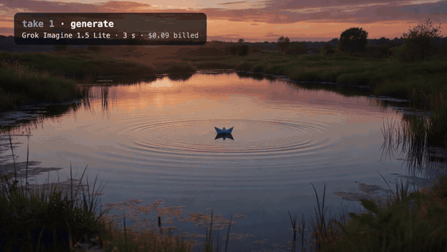

# VibeFrame

**Let your coding agent generate real video, on your own provider keys, under a spend ceiling it cannot cross.**

VibeFrame is a CLI and MCP server for Claude Code, Codex, Cursor, or any bash-capable agent.
It turns a written brief into a plan, generates the assets with frontier models (Seedance, Grok, Runway, Kling, Gemini Omni), and renders a finished MP4.
Every paid step has a dry run and a hard `--max-cost` ceiling.
When a step fails, the agent gets JSON recovery actions it can run next.

[](LICENSE)
[](https://github.com/vericontext/vibeframe/actions/workflows/ci.yml)
[](https://github.com/vericontext/vibeframe/stargazers)


One photographer across a single arctic night: four keyframe stills from one character sheet, animated with Grok image-to-video, cut with `vibe assemble` over a generated score.
It cost about $4.50: $2.84 billed by xAI for the four clips, an estimated $1.59 for the character sheet and stills, and $0.05 metered for the score.
[Watch the full cut](https://github.com/vericontext/vibeframe/releases/download/v0.116.4/vibeframe-showcase-v2.mp4).

## Know the price before anything is spent

`--dry-run` prices the whole build without calling a provider or needing a single key.
Pair it with `--max-cost` and the build refuses to start when the estimate is over your ceiling:

```bash
vibe build film --dry-run --max-cost 3 --json
```

```json
{
  "success": false,
  "error": "Estimated cost $10.93 exceeds --max-cost $3.00.",
  "code": "COST_CAP_EXCEEDED",
  "retryWith": [
    "vibe build . --stage all --skip-backdrop --json",
    "vibe build . --stage all --max-cost 10.93 --json"
  ],
  "data": { "plan": { "estimatedCostUsd": 10.93, "...": "the full priced plan" } }
}
```

The envelope goes to stderr and the command exits 1, so an agent loop stops there.
`retryWith` lists two cheaper commands the agent can run without asking you, and `data.plan` holds the priced plan behind the refusal, so the agent does not have to re-run anything to learn the estimate.

The same dry run names the keys each stage would need, so you can price a video before you sign up with any provider:

```text
Keyframe generation will need openai (OPENAI_API_KEY), but no key/config is available.
Video generation will need seedance (FAL_API_KEY), but no key/config is available.
```

## Every paid call is on record

Each generation is saved as a take: the prompt and parameters, the input and output files by hash, the provider job, and what it cost.
The cost says where the figure came from, so you can tell a provider's bill from an estimate.



```bash
vibe take list --beat dawn          # every take made for one scene
vibe take log --since 2026-11-01    # spend, split into billing and estimates
vibe take promote <take id>         # put an earlier, better take back into the build
vibe take edit <take id> --prompt "make it dusk" --dry-run   # revise a Grok or Omni video in place
```

Review reports name the take behind each problem, so a fix can be a free promote or one edit instead of a whole new scene.
The format is in [docs/take-graph.md](docs/take-graph.md).

## Where VibeFrame fits

It wraps lower-level composition engines rather than replacing them:

| Layer                                                    | Owns                                                                             |
| -------------------------------------------------------- | --------------------------------------------------------------------------------- |
| [Remotion](https://github.com/remotion-dev/remotion)     | React-based programmatic video and component-driven motion graphics.              |
| [Hyperframes](https://github.com/heygen-com/hyperframes) | HTML/CSS/JS scene composition and deterministic browser capture.                  |
| VibeFrame                                                | Frontier-model generation on your own keys, dry runs and the hard `--max-cost` ceiling, storyboard/design files, build reports, render inspection, edit/remix commands, and host-agent guidance. |

VibeFrame hands scene composition to Hyperframes and does the generation itself.
If you only need HTML scenes rendered to video, use Hyperframes directly; `vibe scene install-skill` installs its skill either way.
Use VibeFrame when the job includes paid generation: frontier image and video models, one character across many scenes, narration, cost ceilings, build reports, or edits around the composition.

Without a provider key the pipeline still runs locally for $0, using Kokoro narration, HTML/CSS scenes your agent writes, and headless Chrome with FFmpeg.
That is the cheapest way to check whether the workflow suits you, and [docs/hyperframes.md](docs/hyperframes.md#the-zero-key-render-start-to-finish) walks through it.
The paid generation path below is what VibeFrame is built for.

VibeFrame is not affiliated with HeyGen.
See [CREDITS.md](CREDITS.md) for dependency and provenance notes.

## Install

```bash
curl -fsSL https://vibeframe.ai/install.sh | bash
vibe doctor
```

It needs Node.js 20+, FFmpeg, and Chrome (or Chromium).
`vibe doctor` verifies all three and lists which commands each provider key unlocks.

Only generation needs a key.
FFmpeg edits, Kokoro narration, scene composition, detection, and rendering all run locally.
Add `OPENAI_API_KEY`, `FAL_API_KEY`, `XAI_API_KEY`, `GOOGLE_API_KEY`, `RUNWAY_API_SECRET`, or `KLING_API_KEY` for the providers you use, with `vibe setup` or in the environment.

<details>
<summary>Package names, config locations, and building from source</summary>

The CLI is published as [`@vibeframe/cli`](https://www.npmjs.com/package/@vibeframe/cli) (binary `vibe`) and the MCP server as [`@vibeframe/mcp-server`](https://www.npmjs.com/package/@vibeframe/mcp-server).
The bare `vibeframe` npm package belongs to an unrelated project, so `npx vibeframe` will not run this tool.

The installer places the CLI under the XDG data directory (`~/.local/share/vibeframe` by default).
User-scope keys live in `~/.vibeframe/config.yaml`; `vibe setup --scope project` writes `./.vibeframe/config.yaml`.
When a project config exists at or above your current directory, VibeFrame uses it in isolation and does not merge user-scope keys.

```bash
git clone https://github.com/vericontext/vibeframe.git
cd vibeframe && pnpm install && pnpm build
pnpm vibe --help
```

</details>

## Build a video from a brief

```bash
vibe init launch --from brief.md            # or --from "30-second launch video for VibeFrame"
vibe build launch --dry-run --max-cost 5    # price it
vibe build launch --max-cost 5              # generate
vibe render launch -o renders/final.mp4     # render
vibe inspect render launch --cheap          # check the result
```

`brief.md` can be messy notes, links, or a single line.
What `init` produces is a project you then own:

```text
launch/
  STORYBOARD.md     title, duration, aspect, providers, cast, and the direction prose
  DESIGN.md         palette, typography, layout, motion, transitions
  scenes/
    01-hook.md      one scene per file, in play order
    02-proof.md
    03-close.md
```

Each scene is a markdown file. The frontmatter holds the cues and the body holds the direction:

```markdown
---
type: Scene
duration: 5
narration: "Start with a storyboard. VibeFrame turns each beat into a render plan."
backdrop: "Clean developer terminal beside structured storyboard cues"
video: "media/broll.mp4"
voice: "alloy"
---

Open on the terminal. Let the storyboard cues land before the camera moves.
```

A cue's value is either a prompt to generate from or a project-relative path to a file you already have. `video: "media/broll.mp4"` above reuses your footage, so nothing is generated for it.

Scenes play in filename order, and `vibe storyboard move` reorders them by renumbering. Edit the files yourself, or ask a coding agent to research and revise them.
By convention `media/` holds footage you supply, `assets/` holds generated files, `renders/` holds output, and `vibe.config.json` sets the provider, model, and quality.

Add `--json` to any command for structured output.
`plan`, `build`, `preview`, `render`, and both `inspect` commands take `--beat <id>` to work one beat at a time instead of rebuilding everything.
`storyboard`, `status`, and `scene repair` cover editing beats, polling async work, and deterministic fixes.

Those five are the common cues. There are fifteen in all, and `vibe storyboard validate` warns about anything else.
Profiles (`--profile minimal | agent | full`), [the full cue vocabulary](docs/projects.md#the-cue-vocabulary), and the whole project flow are in [docs/projects.md](docs/projects.md).

## One character across many scenes

The hard part of generated video is making four shots look like the same film.
Declare a character pool in `STORYBOARD.md` and name characters in individual scenes.
VibeFrame generates each character sheet once and edits every scene's keyframe still from it, so the character looks the same in every scene.
Pin the video provider with `providers.video` or a scene's `provider:` cue: Seedance refuses stills with a realistic face, while Grok, Kling, and Runway animate them.

`STORYBOARD.md` declares who exists:

```markdown
---
characters:
  mira: "arctic aurora photographer, deep-red fur-lined parka, dark hair under a charcoal beanie, vintage 35mm camera"
  rival: { image: "media/rival-ref.png" }
---
```

`scenes/01-hook.md` says who is in this shot:

```markdown
---
type: Scene
duration: 5
characters: [mira]
keyframe: "MIRA stands on the frozen ice, camera lowered, looking up as the aurora fills the sky"
video: "slow tilt up as the aurora ripples and pulses overhead"
---
```

Each scene pairs a `keyframe` still with a `video` motion prompt.
Generate the stills first, review them, then animate only the ones you approve.
Stills cost a fraction of the video, so this also keeps a run under its ceiling.

```bash
vibe build my-film --skip-video   # keyframe stills only (cheap) - review them first
vibe build my-film --beat wonder --stage assets --force --skip-video  # redo one beat
vibe build my-film --max-cost 12  # animate the approved stills (image-to-video)
```

Prompt craft for both models lives in the [AI video prompting playbook](docs/ai-video-prompting.md).

## One-off assets and edits

These need no project and no storyboard:

```bash
vibe generate image "cinematic product demo frame" -p openai -o frame.png
vibe generate video "interface animates into a polished demo" -p seedance -i frame.png -o motion.mp4
vibe generate narration "Start with a storyboard." -o narration.mp3

vibe edit silence-cut interview.mp4 -o clean.mp4
vibe edit caption video.mp4 -o captioned.mp4
vibe detect scenes video.mp4

vibe remix highlights demo-process.mp4 -d 60 -o highlight.mp4
vibe audio duck bgm.mp3 --voice highlight.mp4 -o bgm-ducked.mp3
```

For repeatable multi-step work, `vibe run pipeline.yaml` runs a YAML pipeline with a budget, `--dry-run`, and `--resume`.
Worked examples of all of the above are in [docs/recipes.md](docs/recipes.md).

## Drive it from an agent

Your host's agent loop is the outer loop. It drives the CLI with `--json` and keeps `build-report.json` and `review-report.json` as its state.
The build flow above is the forward pass. The recovery pass looks like this:

```text
"fix quality issues from the render review"
-> read review-report.json
-> vibe scene repair launch --json
-> edit STORYBOARD.md or composition artifacts only where needed
-> vibe render launch --json
-> vibe inspect render launch --cheap --json
```

`inspect` returns classified `nextActions`: run the `safeToAutoRun:true` ones automatically, ask before `requiresConfirmation:true`, and use `retryWith` only as a fallback.
`fixOwner` says who acts. `"vibe"` means the CLI can repair it deterministically; `"host-agent"` means the outer loop or a person edits the source files.

You do not have to put any of this in your prompt.
`vibe context` prints it, so "read `vibe context`, then build `launch/` from `brief.md` under `--max-cost 5`" is enough to start a host agent.
The full contract with a worked report is in [docs/projects.md](docs/projects.md#host-agent-loop).

To explore the surface:

```bash
vibe schema --list                  # full command catalog, the source of truth
vibe schema --list --surface public # first-run product path only
vibe schema --list --filter free    # narrow to a cost tier
vibe guide                          # workflow guides (motion | scene | pipeline)
```

## Connect your host

`vibe init` writes one `AGENTS.md`, plus a `CLAUDE.md` that imports it.
Codex, Cursor, Aider, Gemini CLI, OpenCode, and any other bash-capable agent read that same file, so there is no per-host setup.

The CLI is the primary runtime; MCP is for hosts that prefer typed tool calls.
`vibe host` prints config by default, and `--write` applies it:

```bash
vibe host setup all                                   # print snippets for every host
vibe host setup cursor --write                        # write .cursor/mcp.json
vibe host setup claude-desktop ~/dev/videos --write   # pass the workspace dir
vibe host doctor all --json                           # verify what landed
```

In Claude Desktop, install the prebuilt extension instead of editing JSON.
Download [vibeframe.mcpb](https://github.com/vericontext/vibeframe/releases/latest/download/vibeframe.mcpb), drop it into **Settings → Extensions**, then pick a workspace folder.

To wire `@vibeframe/mcp-server` (binary `vibeframe-mcp`) by hand, add:

```json
{
  "mcpServers": {
    "vibeframe": {
      "command": "npx",
      "args": ["-y", "@vibeframe/mcp-server"]
    }
  }
}
```

The tool list is in [packages/mcp-server/README.md](packages/mcp-server/README.md).

## Reference

- [docs/projects.md](docs/projects.md): project files, profiles, characters, keyframes, and the host agent loop.
- [docs/recipes.md](docs/recipes.md): worked end-to-end examples.
- [docs/take-graph.md](docs/take-graph.md): the take record, spend by basis, promote, extend, edit, and prune.
- [docs/hyperframes.md](docs/hyperframes.md): where VibeFrame ends and the composition engine begins, plus the zero-key render.
- [docs/ai-video-prompting.md](docs/ai-video-prompting.md): prompt craft for image and video models.
- [MODELS.md](MODELS.md): provider and model reference.
- [CONTRIBUTING.md](CONTRIBUTING.md): package map, dev setup, tests, and the `pnpm scaffold:*` generators.
- [ROADMAP.md](ROADMAP.md) and [CHANGELOG.md](CHANGELOG.md).

Contributions are welcome: bug fixes, provider integrations, CLI UX improvements, docs, and tests.

## License

MIT. See [LICENSE](LICENSE).
